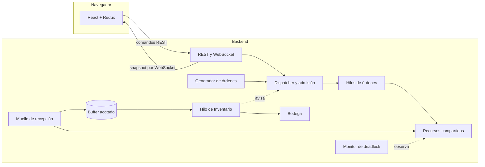
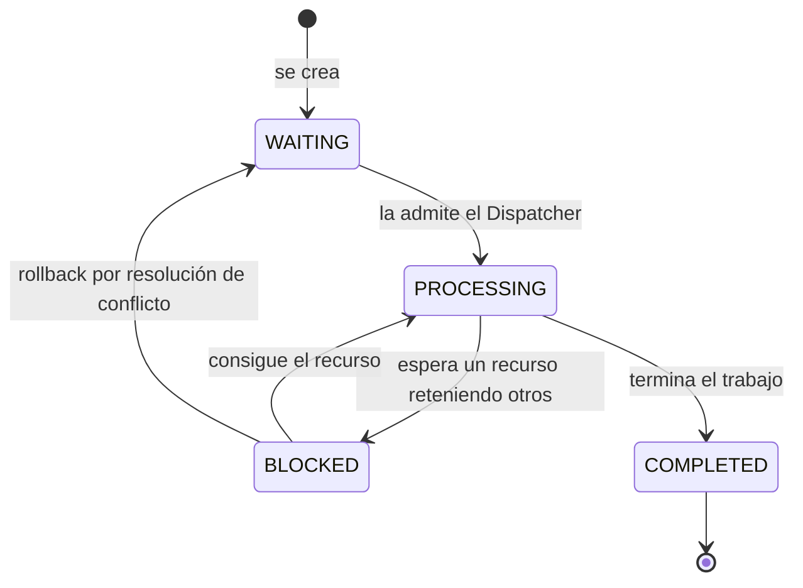
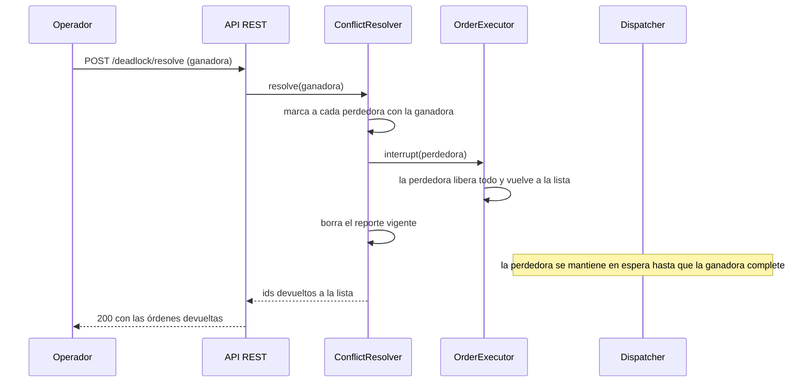
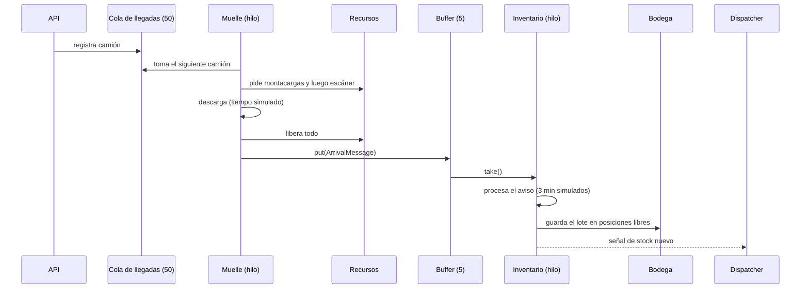

# Manual técnico — REDXela

Este documento describe cómo está construido REDXela, qué decisiones de diseño se tomaron y por qué, y qué conceptos de Sistemas Operativos 2 se aplican en cada parte. Está pensado para quien debe revisar, calificar o extender el proyecto. Para usar la aplicación, consulta el [manual de usuario](manual-usuario.md).

## 1. Resumen y cumplimiento del enunciado

REDXela simula un centro de distribución con recursos compartidos, atendido por **hilos reales de Java** que se sincronizan con semáforos y monitores. El backend (Java 21, Spring Boot 4.1.2, Maven) contiene toda la simulación; el frontend (React 19, TypeScript, Redux Toolkit) solo muestra el estado y envía comandos.

| Requisito del enunciado | Dónde se cumple |
|---|---|
| 6 estaciones de empaque, 2 áreas de carga, 10 empleados, 3 montacargas, 4 estaciones de control de calidad y 1 escáner compartido entre recepción y despacho | `ResourceType` (capacidades) y `ResourcePool`. El escáner lo piden las recepciones (`ReceptionOperation`) y los despachos de mercadería de alto valor y refrigerada (`MerchandiseType`). |
| Bodega con capacidad propia | `Warehouse`: 120 posiciones de 10 unidades (1 200 unidades). |
| Niveles de servicio 1 a 5 | `ServiceLevel`, con una espera máxima prometida por nivel. |
| Generador automático sin límite y órdenes manuales | `OrderGenerator` y `RandomOrderSource`; `POST /api/orders`. |
| Comparación de 3 políticas de planificación | `scheduling/policy` (3 estrategias) y `stats` (mediciones separadas por política). |
| 5 tipos de mercadería con combinaciones distintas de recursos | `MerchandiseType`. |
| Lista de espera con su criterio de orden | `WaitingList` + política activa; el criterio se muestra sobre la lista. |
| Recepción e Inventario comunicados por un buffer acotado | `BoundedBuffer`, `ReceptionArea`, `InventoryWorker`, `ArrivalMessage`. |
| Lotes en ubicaciones no contiguas | `Warehouse`: asignación por posiciones (paginación). |
| Interbloqueo alcanzable y con resolución manual | `ConflictScenario`, `DeadlockDetector`, `DeadlockMonitor`, `ConflictResolver`; prevención con `AcquisitionOrder`. |
| Interfaz con estado de recursos, órdenes en proceso con avance y ETA, lista de espera, estadísticas, entrada manual, recepción y conflicto | `frontend/src/features/*` (un directorio por panel). |
| Código comentado, excepciones controladas y manual técnico con teoría | Comentarios de cabecera en cada clase no trivial; `domain/exception` + `ApiExceptionHandler`; este documento. |

## 2. Arquitectura general



### 2.1 Capas y paquetes

El backend se organiza en paquetes por responsabilidad (`com.redxela`):

| Paquete | Responsabilidad |
|---|---|
| `domain` | Datos puros: clientes, niveles, catálogo, órdenes, excepciones. Sin hilos ni Spring. |
| `resources` | Los seis grupos de recursos, la adquisición y la prevención. |
| `scheduling` | Lista de espera, admisión, `Dispatcher`, ejecución de órdenes y políticas (`policy`). |
| `deadlock` | Detección, monitor, reporte, escenario provocado y resolución. |
| `messaging`, `reception`, `inventory` | Buffer acotado, recepción (productor) e inventario (consumidor). |
| `warehouse` | Almacenamiento físico por posiciones. |
| `generator` | Generador de órdenes aleatorias reproducibles. |
| `stats` | Mediciones por política y muestreo de utilización. |
| `clock` | Tiempo simulado. |
| `config` | Único lugar donde se arma todo (clases `*Config`). |
| `api` | REST, WebSocket, vistas inmutables y manejo de errores. |

### 2.2 Decisión: las clases de la simulación no conocen a Spring

Las clases de `domain`, `resources`, `scheduling`, `deadlock`, etc. son Java normal: no llevan `@Component` ni inyección por anotaciones. Se ensamblan solo en `config/*Config` con `@Bean(initMethod = "start", destroyMethod = "stop")` y `proxyBeanMethods = false`.

- **Por qué:** el comportamiento concurrente es el corazón del proyecto y debe poder leerse, razonarse y probarse sin un contenedor. Un hilo que arranca en el constructor de un componente, o un proxy que intercepta una llamada, ocultan justo lo que se quiere mostrar.
- **Ciclo de vida explícito:** quien arranca un hilo es quien lo detiene (`start`/`stop`), y el contenedor solo invoca esos métodos al iniciar y apagar. Así el cierre es ordenado: cada hilo se interrumpe y termina.
- **Alternativa descartada:** anotar las clases con `@Service`. Mezcla la lógica de concurrencia con la infraestructura y esconde el orden de arranque.

### 2.3 Flujo de información

1. La interfaz **envía comandos** por REST (crear orden, cambiar política, etc.) y recibe una respuesta corta (201, 204 o un error).
2. Un hilo publicador **empaqueta el estado completo** (*snapshot*) y lo envía por WebSocket a todos los navegadores cada 250 ms.
3. La interfaz **solo pinta el último snapshot**; no calcula nada del negocio.

Las razones de este diseño se explican en la sección 11.

## 3. Modelo de dominio

### 3.1 Niveles de servicio

| Nivel | Nombre | Espera máxima prometida (min simulados) |
|---|---|---|
| 1 | Express | 1 |
| 2 | Priority | 10 |
| 3 | Standard | 30 |
| 4 | Scheduled | 60 |
| 5 | Economy | 120 |

El nivel pertenece al **cliente**, no a la orden: todas las órdenes de un cliente tienen su urgencia. El nivel decide con qué prioridad se toma una orden de la lista; la espera prometida sirve para medir el cumplimiento (porcentaje de órdenes atendidas dentro de su objetivo).

### 3.2 Tipos de mercadería y recursos

El **tipo** (no el nivel) decide qué recursos necesita una orden. Cada tipo exige una combinación distinta, y la combinación es una **lista ordenada**: los recursos se piden uno tras otro y se conservan mientras se espera el siguiente.

| Tipo | Recursos, en orden de petición |
|---|---|
| General | 1 personal → 1 estación de empaque |
| Fragile | 1 personal → 1 estación de control de calidad → 1 estación de empaque |
| Heavy | 1 montacargas → 2 personal → 1 área de carga |
| High value | 1 personal → 1 escáner → 1 área de carga |
| Refrigerated | 1 montacargas → 2 áreas de carga → 1 escáner |

*High value* y *Refrigerated* usan el escáner y las áreas de carga **en orden opuesto** (uno toma el escáner y luego pide un área de carga; el otro toma las áreas de carga y luego pide el escáner). Esa pareja es el escenario de contención del proyecto y la base del interbloqueo provocado (sección 7).

Una orden solo puede contener productos de un mismo tipo (`OrderFactory` lo valida y rechaza con 400 el resto). El tipo no lo envía el cliente: se deduce de los productos, de modo que no puede contradecirlos.

### 3.3 Estados de una orden



El trabajo de una orden dura `0.5 min × unidades` de tiempo simulado. `Order` guarda sus campos mutables como `volatile` y las transiciones de varios campos en métodos `synchronized`, porque la escribe el hilo que la ejecuta y la lee, sin esperar, el publicador del snapshot.

### 3.4 Excepciones

`domain/exception` define tres excepciones propias, que `ApiExceptionHandler` traduce a respuestas HTTP con cuerpo `{status, message}`:

| Excepción | HTTP | Ejemplo |
|---|---|---|
| `EntityNotFoundException` | 404 | cliente u orden desconocidos |
| `InvalidRequestException` | 400 | unidades fuera de rango, tipos mezclados, velocidad inválida |
| `CapacityExceededException` | 409 | cola de recepción llena, bodega sin espacio |

Un cuerpo ilegible o con campos faltantes también responde 400. No hay un manejador genérico para cualquier `Exception`: convertiría en 500 los 404 y 405 que Spring ya resuelve bien.

## 4. Concurrencia y sincronización

### 4.1 Hilos del sistema

| Hilo | Cantidad | Qué hace |
|---|---|---|
| `order-worker-N` | uno por orden admitida | Pide recursos, trabaja y los devuelve. |
| `dispatcher` | 1 | Ordena la lista de espera con la política y admite órdenes. |
| `order-generator` | 0 o 1 | Crea órdenes al ritmo configurado. |
| `reception-dock` | 1 | Descarga camiones de uno en uno (productor). |
| `inventory-control` | 1 | Toma avisos del buffer y guarda lotes (consumidor). |
| `deadlock-monitor` | 1 | Busca interbloqueos cada 500 ms. |
| `utilization-sampler` | 1 | Mide el uso de cada recurso cada 250 ms. |
| `auto-replenisher` | 1 | Pide camiones cuando el stock baja. |
| `snapshot-publisher` | 1 | Publica el estado a los navegadores. |

Además actúan los hilos del servidor web que atienden las peticiones REST. Las órdenes se ejecutan en un `ExecutorService` de hilos por demanda (`newCachedThreadPool`): **una orden, un hilo**. Cada orden puede bloquearse esperando un recurso sin frenar a las demás, y eso es exactamente lo que permite que el interbloqueo ocurra y se observe.

### 4.2 Mecanismos usados

| Mecanismo | Dónde | Por qué |
|---|---|---|
| Semáforo contador **justo** (`Semaphore(n, true)`) | Cada `ResourcePool` | Un grupo de recursos idénticos es un semáforo contador. El modo justo atiende en orden de llegada y evita la inanición de quien pide varias unidades. |
| Dos semáforos y un `ReentrantLock` | `BoundedBuffer` | Solución clásica del productor-consumidor (sección 8). |
| `synchronized` (monitor) | `Inventory`, `Warehouse`, `StatsCollector`, `Order`, `SimulationClock` | Varios contadores y estructuras deben cambiar juntos; un monitor da exclusión mutua simple y legible. |
| `ConcurrentHashMap`, `ConcurrentLinkedDeque` | Mapas de dueños y esperas de los pools, lista de espera, historiales | Lecturas sin bloqueo desde el publicador y el monitor. |
| `AtomicBoolean`, `AtomicReference`, `volatile` | Prevención, política activa, reporte de deadlock, campos de progreso | Banderas y referencias de un solo valor: basta visibilidad y atomicidad de la escritura. |
| `DispatchSignal` (semáforo) | Despertar al `Dispatcher` | Cuenta las señales, de modo que una enviada durante una pasada no se pierde (sección 6.2). |
| `interrupt()` | Resolución de conflictos y apagado | Es la forma de sacar a una orden de una espera bloqueante. |

### 4.3 Reglas de diseño aplicadas

- **Ninguna estructura compartida se modifica sin una regla clara de quién la protege.** Cada clase documenta en su comentario de cabecera si es segura entre hilos y cómo.
- **Se lee sin bloquear lo que solo se muestra.** El publicador del snapshot y el monitor de interbloqueo leen copias inmutables (`Map.copyOf`), nunca los mapas vivos. Pueden verlos con microsegundos de atraso; por eso el monitor confirma antes de actuar (sección 7.4).
- **Nada se bloquea eternamente sin poder cancelarse.** Toda espera es interrumpible (`acquire`, `take`, `sleep`) y cada hilo responde a `InterruptedException` restaurando la bandera de interrupción y terminando.
- **Las ventanas de carrera se asumen y se documentan** en lugar de ocultarse (la caminata entre estaciones, la doble confirmación del monitor).

## 5. Gestión de recursos

### 5.1 Un grupo de recursos es un semáforo contador

`ResourcePool` envuelve un `Semaphore` justo con tantas unidades como recursos hay (6 estaciones de empaque, 10 empleados, etc.). Además de bloquear, registra tres mapas por dueño: **quién tiene cuántas unidades** (`holders`), **quién espera cuántas** (`waiters`) y **cuántas están prometidas** a una orden admitida que aún no las pidió (`reservations`). Los dos primeros alimentan la pantalla y el detector de interbloqueo; el tercero, la admisión.

`acquire` primero intenta tomar las unidades sin esperar (`tryAcquire` con tiempo cero, que respeta la cola del semáforo justo). Solo si no puede, avisa que quedó bloqueado y entonces espera. Ese aviso (`onBlocked`) es lo que pasa a la orden a estado **BLOCKED** y lo que muestra la pantalla.

### 5.2 Adquisición incremental: *hold and wait*

`OperationRunner` ejecuta una operación (orden o camión): arma el plan de recursos, los pide **uno por uno conservando los que ya tiene**, trabaja con todos en la mano y los devuelve al final (en un `finally`, aunque haya interrupción o error).

Pedir un recurso mientras se retienen otros es la condición de *retención y espera* de Coffman. Se hizo así a propósito: es lo que hace posible el interbloqueo que el enunciado pide poder alcanzar. Entre una petición y la siguiente hay una **caminata de 1 minuto simulado entre estaciones**; esa pausa es la ventana en la que dos operaciones pueden tomar, cada una, lo que la otra necesita después.

### 5.3 Reserva atómica en la admisión

Para que el funcionamiento normal no se bloquee solo, el `Dispatcher` no admite una orden si no puede **reservar de una vez todos sus recursos y todo su stock** (`ResourceManager.tryReserve`: se reserva todo o nada). Una orden admitida por este camino tiene sus unidades garantizadas, así que las órdenes normales no se bloquean unas a otras: solo pueden esperar un instante a que una operación no reservada (un camión en recepción) suelte lo que tomó. Esto equivale a eliminar la retención y espera **en la admisión**, mientras que el interior de la ejecución sigue siendo incremental.

Solo hay un hilo que reserva (el `Dispatcher`), de modo que comprobar y reservar no se intercala con otro reservador. Las adquisiciones concurrentes solo pueden bajar la disponibilidad, lo que hace la comprobación conservadora (nunca promete de más).

Las órdenes marcadas **inmediatas** saltan la reserva de recursos (no la de stock). Es la vía deliberada para provocar el interbloqueo desde la interfaz.

### 5.4 Prevención por orden global de recursos

`AcquisitionOrder` es el interruptor de prevención. Apagado, cada operación pide sus recursos en el orden de su tipo. Encendido, **todas** los piden por rango ascendente fijo:

| Rango | Recurso |
|---|---|
| 1 | Escáner |
| 2 | Áreas de carga |
| 3 | Montacargas |
| 4 | Estaciones de control de calidad |
| 5 | Estaciones de empaque |
| 6 | Personal |

Si todas las operaciones piden en el mismo orden, no puede formarse una cadena circular de esperas. Quien espera un recurso de rango *k* solo retiene recursos de rango menor que *k*; quien retiene ese recurso *k*, si a su vez espera algo, espera un recurso de rango mayor. Al seguir la cadena de esperas los rangos solo crecen, así que nunca se cierra un círculo. Es la técnica de Havender: se **rompe la condición de espera circular**. La contrapartida es que algunas operaciones piden un recurso antes de lo que lo necesitarían y lo retienen más tiempo, con menos concurrencia efectiva.

## 6. Planificación

### 6.1 Lista de espera y políticas

`WaitingList` es solo almacenamiento sin orden; el orden **se calcula al consultarla**, con la política activa. Por eso cambiar de política reordena toda la lista al instante, y la pantalla y el planificador siempre ven el mismo orden. Cada política es una **estrategia** (`SchedulingPolicy`) que entrega un comparador; el primer elemento es el siguiente en ser atendido. Todas desempatan por llegada y luego por identificador, así que el orden es total y estable.

| Política | Criterio | Teoría | Ventaja | Riesgo |
|---|---|---|---|---|
| Strict priority | Nivel de servicio y, a igual nivel, llegada | Planificación por prioridades | Atiende primero lo urgente | **Inanición:** una orden Economy puede esperar para siempre si siguen llegando órdenes de niveles mejores. |
| Priority with aging | Nivel efectivo = nivel − (espera / 20 min) | Envejecimiento (*aging*) | Elimina la inanición: toda orden termina por ser la más prioritaria | Retrasa un poco a los niveles altos. |
| Fewest items first | Menos unidades primero; luego nivel y llegada | Trabajo más corto primero (SJF) | Minimiza la espera media | Las órdenes grandes pueden quedar relegadas si llegan muchas pequeñas. |

El envejecimiento hace que una orden mejore **un nivel cada 20 minutos de espera**, de modo que una orden Economy que lleva mucho esperando acaba por superar a órdenes Express recién llegadas.

### 6.2 El Dispatcher

El `Dispatcher` es un hilo que, en cada pasada: obtiene la lista ordenada por la política, pregunta a `AdmissionControl` cuáles pueden empezar, las saca de la lista y las entrega al `OrderExecutor`, que lanza un hilo por orden.

Se ejecuta en cada *tick* de 100 ms y también cuando algo puede liberar una orden: llega una orden nueva, termina otra, o Inventario guarda stock. Esas señales se envían con `DispatchSignal`, un **semáforo que cuenta las solicitudes**: si una señal llega mientras el `Dispatcher` está en plena pasada, no se pierde, porque queda contada; y varias señales seguidas se funden en una sola pasada. Así se evita el despertar perdido (*lost wakeup*). También rompe la dependencia circular entre el `Dispatcher` y los componentes que deben despertarlo.

### 6.3 Admisión y contención

`AdmissionControl` recorre la lista en el orden de la política y admite una orden solo si puede reservar sus recursos y su stock. Si no puede, se queda en la lista con su motivo (*Waiting for resources* o *Waiting for stock*).

Hay una regla importante: cuando una orden **no consigue sus recursos, los tipos de recurso que necesita quedan "en disputa"**, y las órdenes que vienen detrás y necesitan alguno de esos mismos tipos **tampoco se admiten en esa pasada**, aunque sí cupieran.

- **Por qué:** sin esta regla, las órdenes pequeñas se colarían una y otra vez delante de una grande que necesita muchos recursos y la dejarían sin atender (inanición), y la política no decidiría realmente quién obtiene los recursos disputados.
- **Qué no afecta:** las órdenes que necesitan otros recursos pasan sin problema.

### 6.4 Resolución de conflictos y diferimiento

Una orden devuelta por una resolución de conflicto no debe ser admitida de nuevo de inmediato, porque reconstruiría el mismo interbloqueo. Por eso queda marcada con la orden ganadora (`deferredUntil`) y `AdmissionControl` la mantiene en la lista, con el motivo *Returned by conflict resolution*, hasta que la ganadora completa.

### 6.5 Estados de espera y su motivo

| Motivo | Significado |
|---|---|
| Waiting for resources | No hay recursos suficientes ahora, o una orden anterior disputa los mismos. |
| Waiting for stock | Faltan unidades de algún producto. |
| Returned by conflict resolution | Fue devuelta tras un interbloqueo y espera a que termine la ganadora. |

## 7. Interbloqueo

### 7.1 Condiciones de Coffman y cómo se cumplen

Un interbloqueo exige que se den a la vez cuatro condiciones (Coffman, Elphick y Shoshani, 1971). El proyecto las deja cumplirse a propósito y las hace visibles:

| Condición | Cómo ocurre en REDXela |
|---|---|
| Exclusión mutua | Una unidad de un recurso sirve a una operación a la vez (semáforo). |
| Retención y espera | `OperationRunner` pide los recursos uno tras otro conservando los que ya tiene. |
| Sin expropiación | Una unidad solo la devuelve su dueño, al terminar. |
| Espera circular | Con tipos que usan los mismos recursos en orden opuesto, dos operaciones pueden esperarse mutuamente. |

### 7.2 El escenario provocado

`ConflictScenario` envía dos órdenes de 2 unidades como **inmediatas** (saltan la reserva de recursos para que arranquen a la vez):

- una de *High value* (producto `VAL-001`): toma personal, luego el **escáner**, y pide un **área de carga**;
- una *Refrigerated* (producto `REF-001`): toma el montacargas, luego las **dos áreas de carga**, y pide el **escáner**.

La caminata de 1 minuto simulado entre una petición y la siguiente da el margen para que cada una tome lo que la otra necesita. Resultado: la primera retiene el escáner y espera un área de carga; la segunda retiene ambas áreas y espera el escáner. Ninguna puede avanzar.

### 7.3 Detección: algoritmo matricial para recursos de varias unidades

Un grafo de asignación de recursos con una sola unidad por recurso no alcanza: el personal tiene 10 unidades intercambiables, y una petición se puede atender mientras haya suficientes libres, sin importar quién tenga las demás. Por eso `DeadlockDetector` usa el **algoritmo de detección para varias instancias por tipo** (Silberschatz et al.), con tres estructuras:

- *Allocation*: qué retiene cada operación.
- *Request*: qué espera cada operación.
- *Available*: unidades libres de cada recurso.

Se parte de *Available* y se repite: si la petición de una operación cabe en lo disponible, esa operación **puede terminar**, así que se suman sus unidades a lo disponible y se la saca del conjunto. Cuando ya no se puede sacar ninguna, **las que quedan están en interbloqueo**.

El detector trabaja sobre copias congeladas de los pools (`PoolState`), no sobre los pools vivos; así es una función pura, sin hilos ni bloqueos, y se razona con facilidad.

### 7.4 Confirmación en dos pasadas

`DeadlockMonitor` revisa cada 500 ms. Los mapas de los pools se leen sin candado, por lo que una sola pasada podría ver a una operación a medio camino entre dos pasos y *creer* que hay un ciclo que no existe. Por eso **solo se reporta un interbloqueo cuando dos pasadas consecutivas encuentran exactamente las mismas operaciones**. Un interbloqueo real no desaparece solo; uno transitorio sí.

- **Costo:** la detección tarda hasta un segundo, irrelevante frente a la duración de un interbloqueo real.
- **Alternativa descartada:** tomar todos los candados de los pools para leer un estado exacto. Detendría la simulación entera cada vez que se mira.

### 7.5 El reporte

`DeadlockReporter` convierte el conjunto de operaciones en un informe legible: para cada una, **qué retiene, qué espera y quién lo tiene**, y una frase final que nombra las cuatro condiciones. Esa explicación se calcula en el servidor, con el mismo estado con el que se detectó el interbloqueo, y la interfaz solo la muestra: así no puede contradecirlo.

### 7.6 Resolución manual por *rollback*



El operador elige qué orden continúa. A cada una de las demás se la **marca con la ganadora** y luego se **interrumpe** su hilo; al ser interrumpida lanza `InterruptedException` mientras espera, `OperationRunner` libera en su `finally` todo lo que tenía, y el `OrderExecutor`, al ver la marca, entiende que es un *rollback* y no un apagado: devuelve las reservas de stock, reinicia la orden y la regresa a la lista de espera. Así se rompe la condición de **no expropiación** (los recursos se le quitan a la perdedora).

El orden importa: la marca se pone **antes** de interrumpir, porque una interrupción sin marca es un cierre del sistema y la orden simplemente se abandona. Los camiones atrapados detrás del interbloqueo no se tocan: avanzan solos cuando los recursos quedan libres.

### 7.7 Por qué no se usa evitación (algoritmo del banquero)

Las estrategias clásicas ante un interbloqueo son **prevenir** (anular una de las cuatro condiciones), **evitar** (conceder un recurso solo si el estado resultante es seguro, como en el algoritmo del banquero) y **detectar y recuperar**. REDXela implementa la primera y la tercera. La evitación exige conocer de antemano el máximo que cada operación llegará a pedir y comprobar cada concesión; aquí esas necesidades sí son conocidas (las define el tipo), pero el enunciado pide que el interbloqueo **pueda ocurrir y resolverse a mano**, y un banquero que lo impidiera siempre lo haría imposible de mostrar. Por eso se implementan, en este orden: provocar, **detectar**, **recuperar** (*rollback* manual) y, como opción activable, **prevenir** (orden global de recursos, sección 5.4).

## 8. Recepción, Inventario y buffer acotado (productor-consumidor)

### 8.1 El problema

Recepción produce avisos de llegada y Inventario los consume a su propio ritmo. Necesitan un canal con **capacidad limitada**: si el productor corre más rápido, debe esperar (no perder datos ni crecer sin límite); si el consumidor no tiene nada que leer, debe dormir sin gastar CPU.

### 8.2 `BoundedBuffer`: tres primitivas

La clase es la solución clásica de Dijkstra, con:

- un **semáforo de posiciones libres**, inicializado en la capacidad (5): `put` lo decrementa y, si es cero, el productor duerme;
- un **semáforo de posiciones ocupadas**, inicializado en 0: `take` lo decrementa y, si es cero, el consumidor duerme;
- un **mutex** (`ReentrantLock`) alrededor de la cola, que protege la estructura de datos de accesos simultáneos.

Los mensajes salen en orden de llegada (FIFO). El orden de las operaciones es esencial: primero se espera en el semáforo y **después** se toma el mutex, nunca al revés, porque un productor que durmiera con el mutex tomado impediría que el consumidor liberase espacio (interbloqueo).

### 8.3 Flujo completo



- La **cola de llegadas** también es acotada (50 camiones): al estar llena, registrar otro responde 409 en lugar de crecer sin límite.
- El muelle es **un solo hilo**: descarga un camión a la vez, y cada descarga es una operación como las órdenes (pide montacargas y luego escáner), por lo que **compite con el despacho por el escáner compartido**.
- Cuando el buffer está lleno, el hilo del muelle espera en `put`; el camión queda en estado *Waiting for Inventory*. Es la **contrapresión**: los camiones se acumulan en la cola en vez de perderse datos.
- Lo único que comparten Recepción e Inventario es el `ArrivalMessage` (id de recepción, producto y unidades). Ninguno toca las estructuras del otro.
- Inventario procesa cada aviso en **3 minutos simulados** (actualizar el stock y asignar las posiciones). Con muchos camiones seguidos es el consumidor el más lento, y el buffer se llena: es el comportamiento que permite observar la contrapresión.
- Al terminar de guardar un lote, Inventario avisa al `Dispatcher` (`DispatchSignal`, sección 6) para que reevalúe las órdenes que esperaban ese producto.
- Si la bodega no tiene espacio, Inventario registra el aviso como *Rejected* con el motivo y sigue; no se detiene.

### 8.4 Reposición automática

Como el generador no se detiene, el stock se agotaría y todas las órdenes terminarían esperando. `AutoReplenisher` revisa cada 5 minutos simulados y, por cada producto con menos de 20 unidades disponibles, envía un camión de 50 unidades **por el mismo camino normal** (cola, muelle, buffer, Inventario), con un enfriamiento de 30 minutos por producto para dar tiempo a que llegue el anterior. Se puede apagar desde la interfaz para estudiar la falta de stock.

## 9. Bodega: asignación no contigua por posiciones

### 9.1 Analogía con la memoria paginada

La bodega se maneja como memoria paginada:

| Memoria | Bodega |
|---|---|
| Marco de página | Posición (*slot*) de 10 unidades |
| Página | Fragmento de 10 unidades de un lote |
| Tabla de páginas | `slotsByLot`: lote → lista de posiciones |
| Proceso | Lote |
| Marcos libres | `TreeSet` de posiciones libres |

Un lote de *n* unidades necesita ⌈*n* / 10⌉ posiciones y se reparte **sobre las primeras posiciones libres**, de menor a mayor índice. Al principio quedan juntas; cuando las órdenes consumen unidades y liberan posiciones intermedias, un lote nuevo cae en **posiciones dispersas, no contiguas**, y aun así se guarda por completo.

### 9.2 Fragmentación

- **Externa: no existe.** Con una asignación contigua, un lote podría no caber aunque hubiera espacio total suficiente, por huecos sueltos. Con posiciones independientes basta con que haya *suficientes* posiciones libres, estén donde estén.
- **Interna: sí, acotada.** La última posición de un lote suele quedar parcialmente llena (un lote de 23 unidades ocupa 3 posiciones, con 7 unidades vacías en la última). La interfaz la dibuja con la altura parcial de la barra.

Si no hay suficientes posiciones libres, `store` lanza `CapacityExceededException` y Inventario rechaza el lote.

### 9.3 Salida de stock

`Inventory` guarda los lotes de cada producto en una cola FIFO: las órdenes consumen del lote **más antiguo** primero (`takeFromLots`), vaciando posiciones en orden y liberando las que quedan en cero. Las **reservas** (`reserved`) garantizan que dos órdenes admitidas nunca se prometan las mismas unidades; `available = onHand − reserved`.

Todos los métodos de `Inventory` y de `Warehouse` son `synchronized` sobre su propio monitor, porque los contadores, las colas de lotes y la tabla de posiciones deben cambiar juntos.

## 10. Tiempo simulado, generador y estadísticas

### 10.1 Reloj

`SimulationClock` define que a velocidad 1 un segundo real es un minuto simulado y permite velocidades de hasta ×20. El tiempo se guarda como un valor base más lo transcurrido desde el último cambio de velocidad, de modo que **cambiar la velocidad nunca hace saltar el reloj**. `sleepMinutes` duerme el hilo en rebanadas de 50 ms hasta alcanzar el instante objetivo, así que todo (trabajo de las órdenes, caminatas, descargas, generador, reposición) respeta la velocidad y puede cancelarse.

### 10.2 Generador reproducible

`RandomOrderSource` produce órdenes aleatorias con **semilla**: la misma semilla da la misma secuencia de clientes, productos y cantidades, de modo que cada política puede medirse contra un flujo de llegadas idéntico. Las llegadas siguen un **proceso de Poisson**: los intervalos entre una orden y la siguiente se distribuyen exponencialmente, `−ln(1 − U) / λ`, el modelo habitual de clientes independientes con un ritmo medio constante λ.

Reglas de la generación:

- Se sortea primero el nivel de servicio, con pesos (10, 15, 30, 25 y 20 % para los niveles 1 a 5), y luego un cliente de ese nivel. El tipo de mercadería se sortea con otros pesos (40, 25, 15, 12 y 8 % para General, Frágil, Pesada, Alto valor y Refrigerada: lo común es lo general y lo raro, lo refrigerado).
- Cada orden lleva de 1 a 3 productos distintos del mismo tipo, con 1 a 8 unidades cada uno. El tipo fija los recursos que la orden necesita.
- No hay límite de órdenes: el generador corre hasta que se detiene, y la lista de espera puede crecer si el sistema no da abasto. Para que la memoria no crezca con ella, `OrderBook` conserva solo las 200 órdenes completadas más recientes y lleva los totales en contadores.

### 10.3 Estadísticas por política

`StatsCollector` mantiene **un acumulador por política** y solo acumula en el de la política activa. Cada acumulador registra por nivel: órdenes completadas, espera total y cuántas se atendieron dentro de su espera prometida; además, el procesamiento total, el tiempo ocupado y el uso acumulado de cada recurso.

- **Espera:** tiempo desde que se creó la orden hasta que fue admitida.
- **Dentro del objetivo:** espera menor o igual a la prometida de su nivel.
- **Órdenes por hora:** completadas / tiempo simulado ocupado de la política. El tiempo ocupado es el que transcurre con al menos una orden abierta (en espera o en proceso); así, cuando el generador se detiene y todo termina, la cifra no sigue bajando mientras el reloj avanza sin trabajo.
- **Utilización:** `UtilizationSampler` mide cada 250 ms el porcentaje de unidades usadas de cada recurso. Cada muestra se pondera por el tiempo simulado que representa (así un cambio de velocidad no sesga el promedio) y solo cuenta mientras hay órdenes abiertas; se promedia por política. Es un muestreo a intervalos fijos que aproxima el uso medio ponderado por tiempo sin tener que intervenir en cada `acquire` y `release`.

`reset` descarta las mediciones de todas las políticas. Todas las operaciones del colector son `synchronized`, porque escriben los hilos de las órdenes y el muestreador, y lee el publicador.

## 11. Capa API

### 11.1 Qué usa cada dirección

- **Interfaz → servidor: REST.** Los comandos son peticiones puntuales con respuesta clara (201, 204 o un error con mensaje).
- **Servidor → interfaz: WebSocket nativo** (`/ws`), unidireccional. La interfaz nunca envía nada por él.

### 11.2 Por qué *snapshot* completo y no eventos

El servidor envía **el estado completo** cada 250 ms. Se descartaron los eventos incrementales ("la orden X cambió") por:

- **Robustez:** si un evento se pierde o llega fuera de orden, la pantalla queda inconsistente hasta recargar. Con el estado completo, el siguiente mensaje la corrige.
- **Simplicidad:** la interfaz no necesita reconstruir el estado ni conocer las reglas del negocio; reemplaza lo que muestra.
- **Reconexión gratuita:** al volver la conexión, el primer mensaje deja todo al día.
- **Costo controlado:** la lista de espera se limita a 100 órdenes (con el total aparte) y las completadas a 15; el JSON se genera **una sola vez** y se envía el mismo texto a todos los navegadores. Con nadie conectado, el publicador no hace nada.

Cada sesión se envuelve en un `ConcurrentWebSocketSessionDecorator` (límite de 2 s de envío y 1 MB de búfer): serializa los envíos y **descarta al cliente que no puede seguir el ritmo**, de modo que un navegador lento no puede bloquear al publicador ni agotar la memoria.

### 11.3 Vistas inmutables

Los controladores nunca exponen las clases de dominio: devuelven `record`s de solo lectura (`OrderView`, `ResourceView`, `Snapshot`, ...) armados por un ensamblador y unos *mappers*. Así, el formato de la API no está atado al modelo interno, y no se escapan campos mutables ni referencias vivas a otros hilos. Los registros que ya eran datos inmutables (`DeadlockReport`, `PolicyStats`, `SlotState`, `ArrivalMessage`) se reutilizan directamente.

### 11.4 Endpoints

| Método y ruta | Descripción | Respuesta |
|---|---|---|
| `GET /api/meta` | Descripción estática: niveles, recursos, políticas, tipos y productos | 200 |
| `GET /api/snapshot` | Estado completo (el mismo que viaja por WebSocket) | 200 |
| `GET /api/clients` | Lista de clientes | 200 |
| `POST /api/clients` | Crea un cliente: `{name, level}` | 201 |
| `POST /api/orders` | Crea una orden: `{clientId, lines:[{sku,units}], immediate?}` | 201 con la orden |
| `GET /api/orders/{id}` | Consulta una orden | 200 o 404 |
| `POST /api/receptions` | Registra un camión: `{sku, units}` | 201 con el camión |
| `PUT /api/simulation/speed` | `{value}`, mayor que 0 y hasta 20 | 204 |
| `PUT /api/simulation/policy` | `{policy}` | 204 |
| `PUT /api/simulation/replenisher` | `{enabled}` | 204 |
| `POST /api/simulation/stats/reset` | Reinicia las mediciones | 204 |
| `POST /api/generator/start` | `{seed?, ordersPerMinute?}` | 204 |
| `POST /api/generator/stop` | Detiene el generador | 204 |
| `PUT /api/generator/rate` | `{value}` en órdenes por minuto, mayor que 0 y hasta 5 | 204 |
| `POST /api/deadlock/provoke` | Crea el escenario de interbloqueo | 201 con `{orders}` |
| `POST /api/deadlock/resolve` | `{winnerId}` | 200 con `{returned}` |
| `PUT /api/deadlock/prevention` | `{enabled}` | 204 |
| `WS /ws` | Flujo de snapshots | — |

Errores: `{status, message}` con 400 (petición inválida o cuerpo ilegible), 404 (no existe) o 409 (capacidad excedida).

### 11.5 Detalles de configuración

- CORS para `/api/**` y orígenes del WebSocket tomados de `redxela.cors.allowed-origins` (por defecto `http://localhost:5173`).
- `Boolean immediate` (envoltorio, no `boolean`) en el cuerpo de la orden: si el cliente no lo menciona llega `null` y se trata como falso. Con un tipo primitivo, un campo ausente haría fallar la deserialización.
- Cada clase `*Config` arma un grupo de componentes (`CoreConfig`, `SchedulingConfig`, `FlowConfig`, `DeadlockConfig`); `SimulationStartup` carga los datos iniciales al arrancar.

## 12. Frontend

### 12.1 Tecnología

React 19, TypeScript estricto (sin `enum` ni propiedades de parámetro, imports de solo tipos), Redux Toolkit con `react-redux`, iconos de `lucide-react` (uno por panel), Vite y `oxlint`. Los estilos son **CSS Modules** sobre *tokens* de diseño (`styles/tokens.css`): un tema oscuro (por defecto) y uno crema comparten los mismos nombres de variable y cambiar de tema solo cambia un atributo del documento; la elección se guarda en el navegador. El texto usa una sola familia (Inter, con números tabulares para alinear las cifras) y una escala de tres tamaños definida como variables (`--text-sm`, `--text-md` y `--text-lg`: 13, 15 y 18 px), de modo que cambiar el tamaño de toda la interfaz es editar tres valores.

### 12.2 Estado

El almacén de Redux tiene cuatro *slices*:

| Slice | Contenido |
|---|---|
| `snapshot` | El último snapshot completo. Cada mensaje **reemplaza** al anterior. Arranca con un snapshot vacío para que ningún panel tenga que manejar "sin datos". |
| `connection` | `connecting`, `open` o `closed`. |
| `catalog` | Datos de cambio lento pedidos por REST: `meta` y clientes. |
| `ui` | Tema y último aviso. |

Los componentes leen con **selectores con nombre** (`selectInProcess`, `selectStock`, ...) y no navegan el estado a mano.

### 12.3 Comunicación

- **`socket.ts`** abre el WebSocket, envía cada mensaje al almacén y, si se cae, **reintenta con espera creciente** (hasta 5 s). Al conectar recarga el catálogo, porque un backend reiniciado vuelve a sus datos iniciales.
- **`http.ts`** tiene una función por endpoint y convierte cualquier fallo en un `ApiRequestError` con el mensaje del servidor.
- **`useCommand`** es el único camino para enviar comandos: muestra el mensaje de error del servidor o una confirmación, y tras un éxito pide un snapshot fresco para reflejar el cambio al instante en vez de esperar al siguiente envío periódico.

### 12.4 Organización

El código se agrupa por función, igual que el backend: `features/header`, `controls`, `conflict`, `resources`, `orders`, `entry`, `reception`, `stock`, `warehouse`, `stats`. Los componentes genéricos (`Panel`, `Badge`, `Button`, `ProgressBar`, `Segmented`, `Toggle`, `Field`, `Section`, `Scroll`, `Empty`, `Notice`) están en `components/`. Los componentes son pequeños y cada panel lee solo lo que necesita.

## 13. Configuración y ejecución

| Propiedad / variable | Efecto | Por defecto |
|---|---|---|
| `server.port` (`PORT`) | Puerto HTTP del backend | `8080` |
| `redxela.cors.allowed-origins` | Orígenes permitidos para REST y WebSocket | `http://localhost:5173` |
| `redxela.generator.autostart` | Inicia el generador al arrancar | `false` |
| `redxela.snapshot.interval-millis` | Periodo del snapshot | `250` |
| `VITE_API_URL` (frontend) | Dirección del backend; la del WebSocket se deriva de ella | `http://localhost:8080` |

```bash
# Backend
cd backend && ./mvnw spring-boot:run

# Frontend (desarrollo)
cd frontend && npm install && npm run dev

# Frontend (verificación y empaquetado)
cd frontend && npm run lint && npm run build
```

No hay base de datos: todo está en memoria, y es el diseño buscado (el objeto de estudio son los hilos y la sincronización, no la persistencia).

## 14. Decisiones de diseño y alternativas

| Decisión | Alternativa descartada | Razón |
|---|---|---|
| Hilos reales, una orden por hilo | Simulación por eventos en un solo hilo | El enunciado pide concurrencia real; el interbloqueo solo es auténtico si hay hilos que de verdad se bloquean. |
| Semáforos contadores justos para los recursos | Candados (`ReentrantLock`) por unidad | Un grupo de unidades idénticas es, por definición, un semáforo contador; el modo justo evita la inanición. |
| Adquisición incremental con retención | Tomar todo de una vez | Es lo que permite el interbloqueo pedido; la admisión sí reserva todo de una vez para el uso normal. |
| Detección matricial para varias instancias | Grafo de espera de una unidad por recurso | Los grupos tienen varias unidades intercambiables. |
| Confirmar el interbloqueo en dos pasadas | Congelar el sistema para observarlo | Detener la simulación cada medio segundo es peor que un segundo de retraso. |
| Resolver por *rollback* manual con diferimiento | Terminar la orden perdedora | La orden no se pierde; vuelve a la lista y no reconstruye el mismo bloqueo al esperar a la ganadora. |
| Prevención por orden global (Havender) | Evitación con el algoritmo del banquero | Se conoce lo que pide cada tipo, pero el enunciado pide poder provocar y resolver el conflicto; el orden global es simple y demostrable. |
| Buffer con dos semáforos y un mutex | `BlockingQueue` de Java | Mostrar la solución clásica del productor-consumidor; el comportamiento es el mismo. |
| Bodega por posiciones (paginación) | Asignación contigua | Elimina la fragmentación externa y hace visible la no contigüidad. |
| Políticas como estrategias con comparador | `if` por política dentro del planificador | Agregar una política es agregar una clase; el criterio se muestra en pantalla. |
| Bloquear las órdenes que disputan un recurso con una anterior | Dejar que las pequeñas se cuelen | Evita la inanición y hace que la política decida quién obtiene los recursos disputados. |
| Snapshot completo por WebSocket | Eventos incrementales | Robustez ante pérdida y reconexión; ver sección 11.2. |
| Vistas inmutables (`record`) en la API | Exponer las clases de dominio | Desacopla el contrato del modelo y evita fugas de estado mutable. |
| Simulación sin Spring, ensamblada en `config` | Anotar con `@Component` | La concurrencia debe poder leerse sin contenedor; ver sección 2.2. |
| Un solo estado en memoria | Base de datos | Fuera del alcance del curso; los datos son efímeros por naturaleza. |

## 15. Limitaciones y trabajo futuro

- **Persistencia:** nada sobrevive a un reinicio. Es deliberado, pero un historial de ejecuciones permitiría comparar políticas entre corridas.
- **Un solo muelle de recepción:** modelar varios muelles aumentaría la contención por el escáner y por los montacargas.
- **Comparación de políticas:** como las mediciones de cada política solo se acumulan mientras está activa, una comparación rigurosa requiere reiniciar entre políticas con la misma semilla (ver el manual de usuario, sección 5.6). Un modo que ejecute las tres en paralelo sobre el mismo flujo la haría exacta.
- **Muestreo de utilización:** es una aproximación a intervalos fijos. Registrar el tiempo exacto en cada `acquire` y `release` daría el uso ponderado por tiempo.
- **Evitación de interbloqueos:** el algoritmo del banquero no está implementado (sección 7.7).
- **Seguridad:** no hay autenticación; la API está pensada para un entorno de laboratorio.
- **Escala del snapshot:** el estado completo cada 250 ms es adecuado para decenas de navegadores; con muchos más convendría enviar diferencias.

## 16. Referencias

- Silberschatz, A., Galvin, P. B., Gagne, G. *Operating System Concepts*. Wiley. Capítulos de sincronización, planificación, interbloqueos y gestión de memoria.
- Tanenbaum, A. S., Bos, H. *Modern Operating Systems*. Pearson. Productor-consumidor, interbloqueos y paginación.
- Dijkstra, E. W. (1965). *Cooperating Sequential Processes*. Semáforos y el problema del buffer acotado.
- Coffman, E. G., Elphick, M. J., Shoshani, A. (1971). *System Deadlocks*. ACM Computing Surveys. Las cuatro condiciones.
- Havender, J. W. (1968). *Avoiding deadlock in multitasking systems*. IBM Systems Journal. Prevención por orden de recursos.
