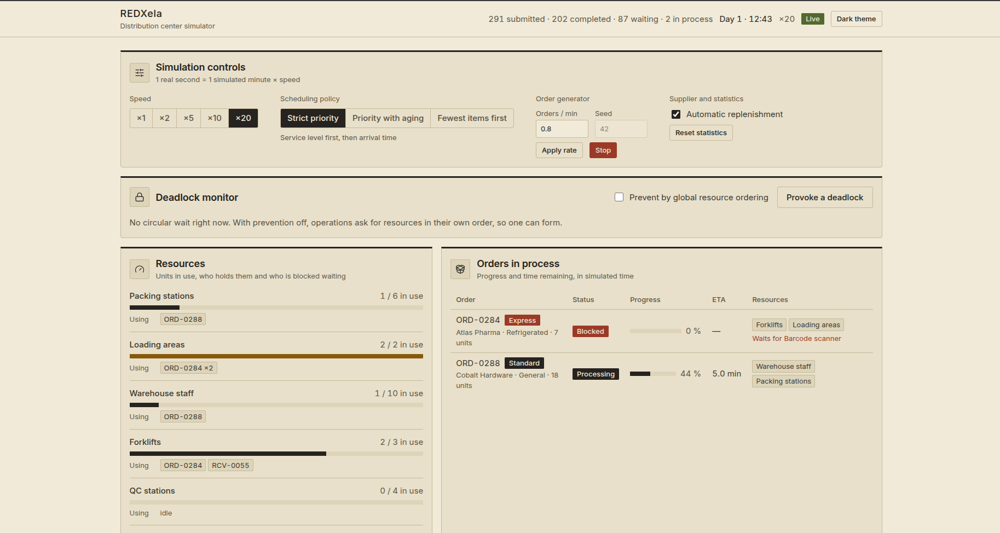
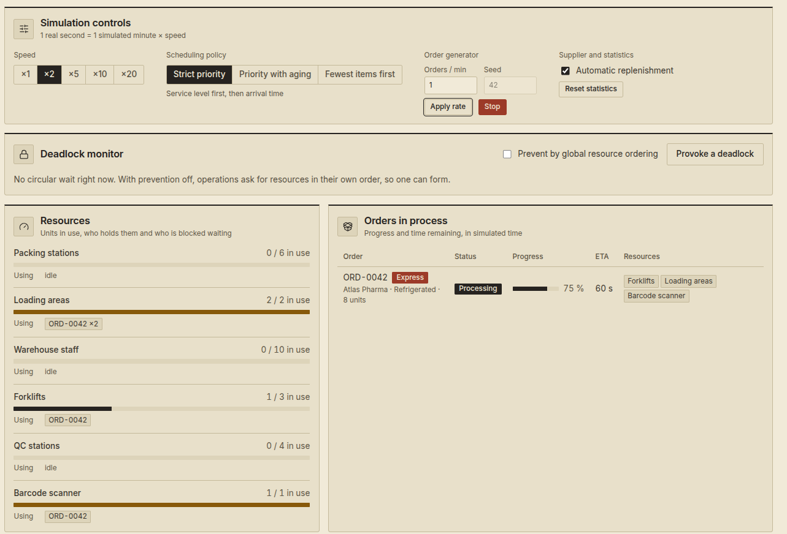
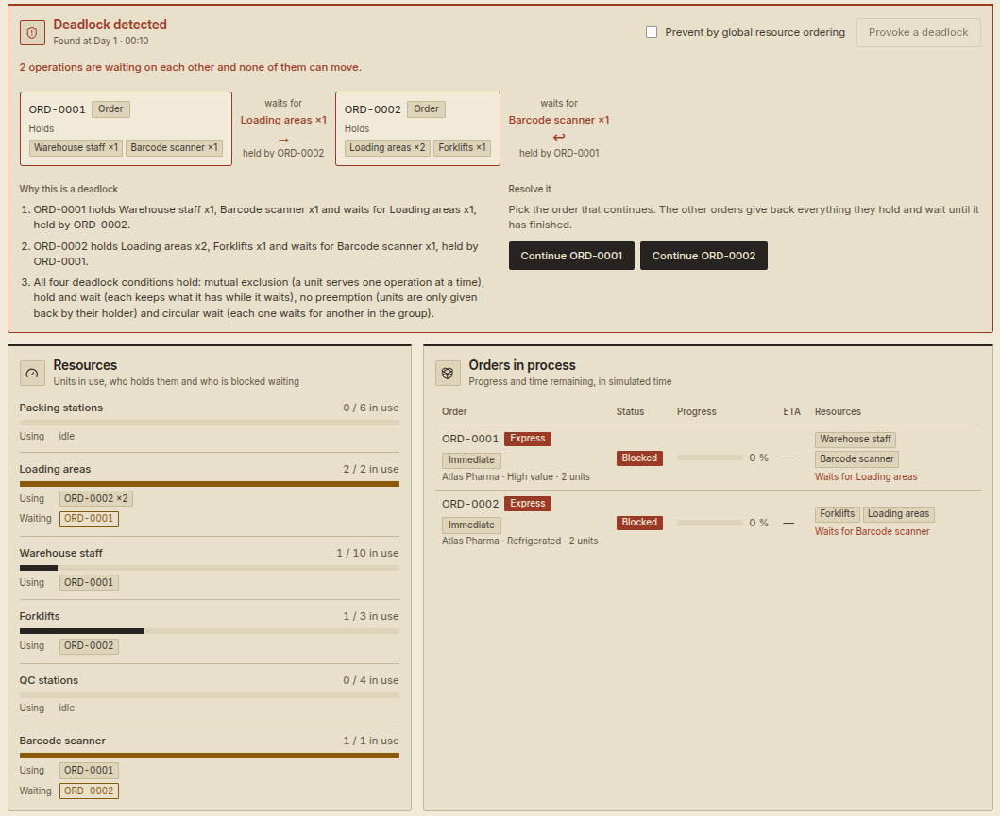
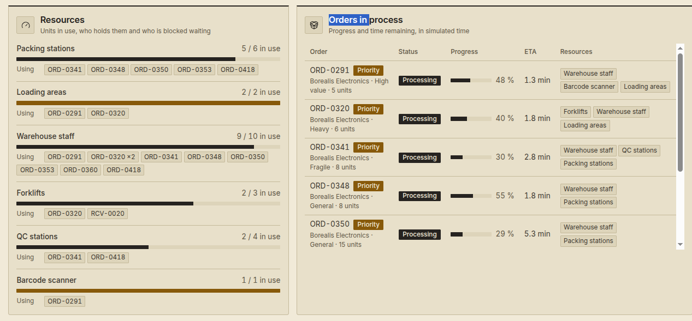
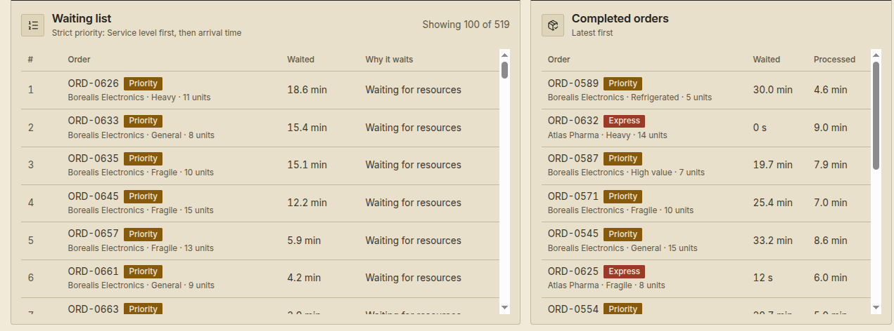
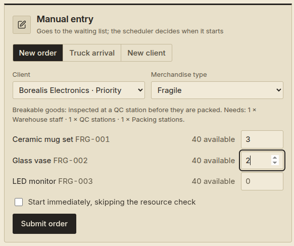
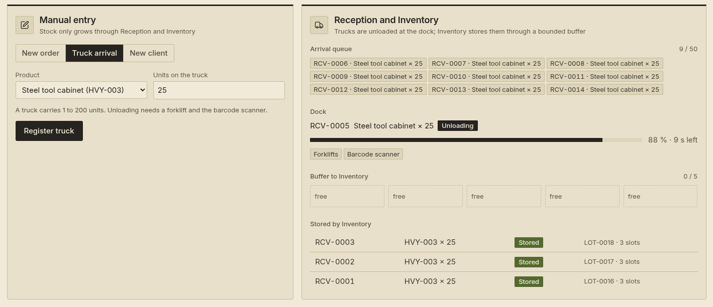
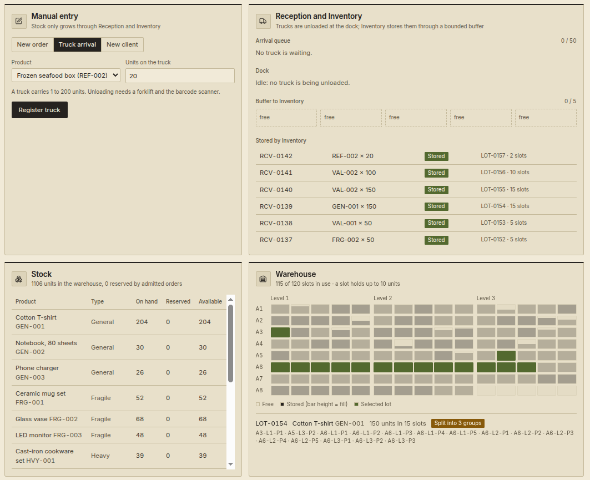
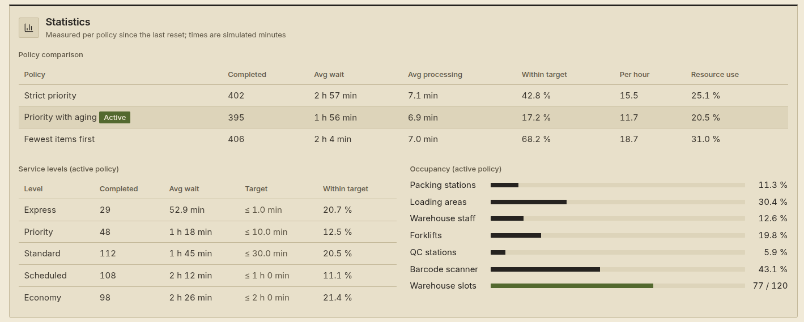

# Manual de usuario — REDXela

REDXela es un simulador de un centro de distribución. Recibe camiones de proveedores, guarda la mercadería en una bodega, atiende pedidos de clientes con recursos compartidos (estaciones de empaque, montacargas, personal, etc.) y muestra en vivo qué está pasando. Sirve para observar cómo se comportan distintas políticas de planificación y para provocar y resolver un interbloqueo (*deadlock*) a propósito.

Este manual explica cómo ejecutar la aplicación, qué muestra cada parte de la pantalla y cómo hacer las pruebas más comunes. Para los detalles de diseño e implementación, consulta el [manual técnico](manual-tecnico.md).

> La interfaz está en inglés; en este manual los nombres de paneles, botones y estados aparecen entre comillas tal como se ven en pantalla.

## 1. Requisitos

| Componente | Versión |
|---|---|
| JDK | 21 |
| Node.js | 20.19 o superior (o 22.12 o superior) |
| Maven | no hace falta instalarlo: el repositorio incluye el *wrapper* (`mvnw`) |
| Navegador | uno moderno (Chrome, Firefox, Edge, Safari) |

No se necesita base de datos: todo el estado vive en memoria y se pierde al detener el backend.

## 2. Instalación y ejecución

El repositorio tiene dos carpetas: `backend/` (Java, Spring Boot) y `frontend/` (React). Se ejecutan por separado, cada una en su terminal.

### 2.1 Backend

```bash
cd backend
./mvnw spring-boot:run
```

Cuando termina de arrancar aparece en la consola una línea como:

```
Simulation ready: 5 clients, 15 products in stock
```

El backend queda escuchando en `http://localhost:8080`. Al iniciar crea cinco clientes (uno por cada nivel de servicio) y 40 unidades de cada uno de los 15 productos, para que haya con qué trabajar desde el primer segundo.

### 2.2 Frontend

```bash
cd frontend
npm install
npm run dev
```

Abre `http://localhost:5173`. Si todo está bien, arriba a la derecha aparece la etiqueta verde **Live** y el reloj simulado empieza a avanzar.

### 2.3 Configuración opcional

| Qué | Cómo | Por defecto |
|---|---|---|
| Puerto del backend | variable de entorno `PORT` | `8080` |
| Origen permitido del frontend (CORS) | propiedad `redxela.cors.allowed-origins` | `http://localhost:5173` |
| Iniciar el generador automático al arrancar | propiedad `redxela.generator.autostart=true` | `false` |
| Frecuencia de envío del estado a la pantalla | propiedad `redxela.snapshot.interval-millis` | `250` |
| Dirección del backend que usa el frontend | variable `VITE_API_URL` (en `frontend/.env`) | `http://localhost:8080` |

Ejemplo: arrancar el backend en otro puerto y apuntar el frontend hacia él.

```bash
PORT=9090 ./mvnw spring-boot:run
echo "VITE_API_URL=http://localhost:9090" > frontend/.env
```

## 3. Cómo pasa el tiempo

La simulación usa **tiempo simulado**. Con velocidad ×1, un segundo real equivale a un minuto simulado; con ×20, un segundo real son veinte minutos simulados (una hora simulada pasa en 3 segundos). Todos los tiempos que muestra la pantalla (espera, procesamiento, ETA) están en minutos simulados. El reloj de la cabecera indica el día y la hora simulados, por ejemplo `Day 1 · 09:41`.

## 4. Recorrido por la pantalla



### 4.1 Cabecera

- **Contadores:** órdenes recibidas (*submitted*), completadas, en espera (*waiting*) y en proceso (*in process*).
- **Reloj simulado** y velocidad actual (`×1`, `×5`, ...).
- **Deadlock:** etiqueta roja que solo aparece mientras exista un interbloqueo.
- **Estado de la conexión:** *Live* (verde) si la pantalla recibe datos; *Connecting* (ámbar) al reconectar; *Offline* (rojo) si no hay conexión con el backend. La pantalla reintenta sola.
- **Cream theme / Dark theme:** cambia entre el tema oscuro (por defecto) y el crema. Se recuerda en el navegador.

### 4.2 "Simulation controls"



- **Speed:** `×1`, `×2`, `×5`, `×10`, `×20`. Cambiarla no hace saltar el reloj.
- **Scheduling policy:** la política que decide el orden de la lista de espera. Debajo se lee su criterio. Cambiarla reordena la lista al instante. Hay tres:
  - *Strict priority:* primero el nivel de servicio más urgente; empata por llegada.
  - *Priority with aging:* igual, pero cada 20 minutos de espera la orden mejora un nivel.
  - *Fewest items first:* primero la orden con menos unidades; luego nivel y llegada.
- **Order generator:** produce órdenes automáticas sin límite hasta que se detiene.
  - *Orders / min:* ritmo medio (de 0.1 a 5; por defecto 0.4).
  - *Seed:* número que fija la secuencia aleatoria; con la misma semilla se repite exactamente el mismo flujo de pedidos. Vacío usa una semilla por defecto.
  - **Start generator / Stop**, y **Apply rate** para cambiar el ritmo en marcha.
- **Automatic replenishment:** un proveedor simulado envía camiones cuando un producto tiene menos de 20 unidades disponibles. Apágalo para estudiar qué ocurre cuando el stock se agota.
- **Reset statistics:** borra las mediciones de todas las políticas.

### 4.3 "Deadlock monitor"

Muestra si hay un interbloqueo. Normalmente está en calma. Contiene:

- **Prevent by global resource ordering:** interruptor de prevención (ver 5.5).
- **Provoke a deadlock:** crea a propósito dos órdenes que se bloquean entre sí.

Cuando hay un interbloqueo, el panel se pone rojo y muestra el ciclo de espera, la explicación y los botones para resolverlo (ver 5.4).



### 4.4 "Resources"



Los seis recursos compartidos, cada uno con su barra de uso (`usadas / total`):

| Recurso | Unidades |
|---|---|
| Packing stations | 6 |
| Loading areas | 2 |
| Warehouse staff | 10 |
| Forklifts | 3 |
| QC stations | 4 |
| Barcode scanner | 1 (compartido entre recepción y despacho) |

Debajo de cada barra, *Using* lista quién las tiene (`ORD-0012 ×3` significa tres unidades) y, solo si hay alguien, *Waiting* lista en ámbar las operaciones bloqueadas esperando ese recurso.

### 4.5 "Orders in process"

Las órdenes que ya salieron de la lista de espera:

- **Status:** *Processing* (trabajando) o *Blocked* (tiene algunos recursos y espera otro).
- **Progress** y **ETA:** avance y tiempo simulado restante. Una orden bloqueada no tiene ETA.
- **Resources:** los recursos que tiene en su poder y, en rojo, el que le falta (*Waits for ...*).

### 4.6 "Waiting list"



Las órdenes que aún no empiezan, en el orden que dicta la política activa (la primera es la siguiente en entrar). Bajo el título se muestra la política y su criterio. Columnas:

- **#** posición, **Order** (id, nivel, cliente, tipo y unidades), **Waited** (tiempo esperado).
- **Why it waits:** *Waiting for resources*, *Waiting for stock* o *Returned by conflict resolution* (con "until ORD-xxxx finishes").
- Si hay más de 100, se indica *Showing 100 of N*.

La etiqueta **Immediate** junto a una orden indica que fue creada para saltarse la revisión de recursos (se usa para provocar el interbloqueo).

### 4.7 "Completed orders"

Las últimas 15 órdenes terminadas, con su tiempo de espera y de procesamiento.

### 4.8 "Manual entry"



Tres pestañas:

- **New order:** elige cliente y *Merchandise type*. Una orden solo puede llevar productos de un mismo tipo, porque el tipo define qué recursos necesita; por eso se elige primero. Debajo se lee qué recursos pide ese tipo. Escribe unidades (1 a 100) junto a cada producto que quieras incluir y deja vacíos los demás. Al lado de cada producto se ve cuántas unidades están disponibles. **Start immediately, skipping the resource check** salta la revisión de recursos (se usa para experimentos de interbloqueo).
- **Truck arrival:** registra un camión de un producto (1 a 200 unidades).
- **New client:** agrega un cliente con su nivel de servicio.

Si algo no es válido, el botón se desactiva o el servidor responde con un mensaje que aparece abajo a la derecha unos segundos.

### 4.9 "Reception and Inventory"



Muestra el recorrido de la mercadería que entra, de arriba abajo:

1. **Arrival queue:** camiones esperando turno (hasta 50).
2. **Dock:** el camión que se está descargando (hay un solo muelle), con su avance y los recursos que usa (montacargas y escáner).
3. **Buffer to Inventory:** cinco casillas. Cuando el muelle termina de descargar, deja un aviso aquí y *Inventory* lo toma para guardar el lote. Si las cinco están ocupadas aparece *Full: the dock waits* y el muelle espera.
4. **Stored by Inventory:** los últimos avisos procesados: *Stored* con el lote y la cantidad de posiciones usadas, o *Rejected* con el motivo (por ejemplo, bodega llena).

### 4.10 "Stock"

Por producto: unidades en bodega (*On hand*), prometidas a órdenes ya admitidas (*Reserved*) y libres (*Available*). Un número en ámbar indica poco stock y en rojo, agotado.

### 4.11 "Warehouse"



120 posiciones, de 10 unidades cada una (1 200 unidades en total), dibujadas por pasillo (A1 a A8) y nivel de estante (Level 1 a 3, cinco posiciones por nivel). La altura de la barra de cada posición indica cuánto está lleno. **Pasa el mouse sobre una posición** para resaltar todas las posiciones de su lote; abajo aparece el lote, el producto, las unidades, la lista de ubicaciones y si está *Contiguous* o *Split into N groups*. Los lotes vecinos se pintan con tonos alternados para distinguirlos.

### 4.12 "Statistics"



- **Policy comparison:** una fila por política con órdenes completadas, espera media, procesamiento medio, porcentaje atendido dentro del objetivo de su nivel, órdenes por hora y uso medio de recursos. La fila de la política activa está resaltada. **Cada política solo acumula mientras está activa.** Las columnas *Per hour* y *Resource use* solo cuentan el tiempo en que hay órdenes abiertas (en espera o en proceso): si detienes el generador y dejas que todo termine, no siguen bajando por el tiempo ocioso.
- **Service levels (active policy):** por nivel, completadas, espera media, objetivo (*Target*) y porcentaje dentro del objetivo.
- **Occupancy (active policy):** uso medio de cada recurso y cuántas posiciones de la bodega están ocupadas.

Hasta que se completa la primera orden, los promedios aparecen como "—".

## 5. Guías paso a paso

### 5.1 Primera simulación

1. Con backend y frontend en marcha, pulsa **Speed ×5**.
2. Pulsa **Start generator** (déjalo en 0.4 órdenes por minuto).
3. Observa: los contadores suben, *Resources* se llena, aparecen órdenes en *Orders in process* y la lista de espera crece o se vacía según la carga.
4. Cuando quieras parar, pulsa **Stop**.

### 5.2 Crear una orden a mano

1. Ve a **Manual entry → New order**.
2. Elige un cliente y un tipo (por ejemplo *Fragile*).
3. Escribe unidades en uno o más productos y pulsa **Submit order**.
4. La orden aparece en *Waiting list* o, si hay recursos libres, directo en *Orders in process*.

### 5.3 Registrar un camión

1. Ve a **Manual entry → Truck arrival**, elige producto y unidades (por ejemplo 50) y pulsa **Register truck**.
2. Sigue el recorrido en *Reception and Inventory*: cola, muelle, casilla del buffer, fila en *Stored by Inventory*.
3. El stock sube y la bodega muestra el lote nuevo. Para llenar el buffer, sube la velocidad a ×20 y registra varios camiones seguidos.

### 5.4 Provocar y resolver un deadlock

1. Pulsa **Provoke a deadlock**. Se crean dos órdenes inmediatas que necesitan el escáner y las áreas de carga en orden opuesto: una de mercadería de alto valor (toma el escáner y luego pide un área de carga) y una refrigerada (toma las dos áreas de carga y luego pide el escáner).
2. En unos segundos el panel se pone rojo y aparece la etiqueta **Deadlock**. Verás el ciclo: cada orden con lo que retiene, lo que espera y quién lo tiene.
3. Lee **Why this is a deadlock**: describe quién retiene qué y las cuatro condiciones que lo hacen permanente.
4. Resuélvelo con **Continue ORD-xxxx**: esa orden conserva sus recursos y continúa; las demás los devuelven y vuelven a *Waiting list* con el motivo *Returned by conflict resolution*, esperando a que la elegida termine.
5. El panel vuelve a la calma y la orden elegida termina.

### 5.5 Evitarlo con prevención

1. Activa **Prevent by global resource ordering**.
2. Pulsa **Provoke a deadlock** de nuevo: las órdenes ahora piden los recursos siempre en el mismo orden global y avanzan sin bloquearse.
3. Desactívalo para volver al comportamiento original.

### 5.6 Comparar las tres políticas

**Rápida, en una sola ejecución:**
1. Fija una semilla (por ejemplo 42), velocidad ×20 y un ritmo (por ejemplo 0.8).
2. Elige *Strict priority*, pulsa **Start generator** y deja correr unas 8 horas simuladas (24 segundos reales a ×20).
3. Cambia a *Priority with aging* y deja pasar el mismo tiempo; repite con *Fewest items first*.
4. Compara las tres filas de *Policy comparison*.

Es aproximada: al cambiar de política queda una cola heredada de la anterior y el flujo de órdenes continúa en lugar de repetirse.

**Rigurosa, reiniciando:** detén el backend, vuelve a arrancarlo, elige la política, inicia el generador con la misma semilla y ritmo, deja pasar el mismo tiempo simulado y anota la fila. Repite para cada política. Así las tres ven exactamente el mismo flujo de pedidos desde el mismo estado inicial.

### 5.7 Estudiar la falta de stock

1. Apaga **Automatic replenishment**.
2. Inicia el generador con un ritmo alto (por ejemplo 2).
3. Cuando un producto llega a 0 en *Stock*, sus órdenes pasan a *Waiting for stock* en la lista de espera.
4. Registra un camión de ese producto en *Truck arrival*: al guardarse, las órdenes pendientes arrancan.

## 6. Referencia

### 6.1 Niveles de servicio

| Nivel | Nombre | Espera máxima prometida |
|---|---|---|
| 1 | Express | 1 minuto |
| 2 | Priority | 10 minutos |
| 3 | Standard | 30 minutos |
| 4 | Scheduled | 60 minutos |
| 5 | Economy | 120 minutos |

Los clientes iniciales son: Atlas Pharma (1), Borealis Electronics (2), Cobalt Hardware (3), Delta Home Goods (4) y Ember Outlet (5).

### 6.2 Tipos de mercadería y recursos que usan

Los recursos se piden uno tras otro en el orden en que están escritos, y se conservan mientras se espera el siguiente.

| Tipo | Recursos (en orden de petición) |
|---|---|
| General | 1 Warehouse staff → 1 Packing station |
| Fragile | 1 Warehouse staff → 1 QC station → 1 Packing station |
| Heavy | 1 Forklift → 2 Warehouse staff → 1 Loading area |
| High value | 1 Warehouse staff → 1 Barcode scanner → 1 Loading area |
| Refrigerated | 1 Forklift → 2 Loading areas → 1 Barcode scanner |

Un camión en recepción usa 1 Forklift y luego el Barcode scanner. Una orden trabaja 0.5 minutos simulados por unidad; un camión, 0.05 por unidad (mínimo 0.5).

### 6.3 Estados

- **Orden:** *Waiting* (en la lista), *Processing*, *Blocked* (espera un recurso con otros en la mano), *Completed*.
- **Camión:** *Queued*, *Unloading*, *Blocked*, *Waiting for Inventory*, *Sent*.

## 7. Solución de problemas

| Síntoma | Causa probable y solución |
|---|---|
| La etiqueta dice **Offline** | El frontend no alcanza al backend. Comprueba que el backend esté arrancado y que `VITE_API_URL` apunte a su dirección. La pantalla reintenta sola. |
| Sale error de red o de CORS en la consola del navegador | El origen del frontend no está permitido. Arranca el backend con `redxela.cors.allowed-origins` igual a la dirección desde la que abres el frontend. |
| El puerto 8080 o el 5173 ya está en uso | Usa otro puerto (`PORT` para el backend; `npm run dev -- --port 5174` para el frontend, y añade ese origen al CORS del backend). |
| **New order** dice "Add a client first" | La lista de clientes aún no cargó o está vacía. Crea uno en **New client**. |
| Un mensaje rojo al enviar una orden | Lee el texto: el servidor explica el motivo (por ejemplo, unidades fuera de rango o productos de tipos distintos). |
| **Provoke a deadlock** no provoca nada | Con la prevención activada es lo esperado. Desactívala. |
| Todo se ve en ceros | Aún no hay datos: espera a ver *Live* o recarga la página. |
| Se perdió todo tras reiniciar el backend | Es lo normal: el estado vive solo en memoria y se reinicia con los datos iniciales. |

## 8. Glosario

- **Orden:** pedido de un cliente con uno o más productos del mismo tipo.
- **Recurso:** unidad limitada y compartida (estación de empaque, montacargas, etc.).
- **Lista de espera:** órdenes que aún no empiezan, ordenadas por la política activa.
- **Política de planificación:** regla que decide quién va primero.
- **Interbloqueo (*deadlock*):** dos o más operaciones que se esperan mutuamente para siempre.
- **Lote:** conjunto de unidades de un mismo producto recibido en un camión, guardado en una o más posiciones.
- **Posición (*slot*):** espacio de la bodega con capacidad de 10 unidades.
- **Buffer:** cola acotada por donde Recepción avisa a Inventario.
- **Snapshot:** foto completa del estado que el backend envía a la pantalla varias veces por segundo.
